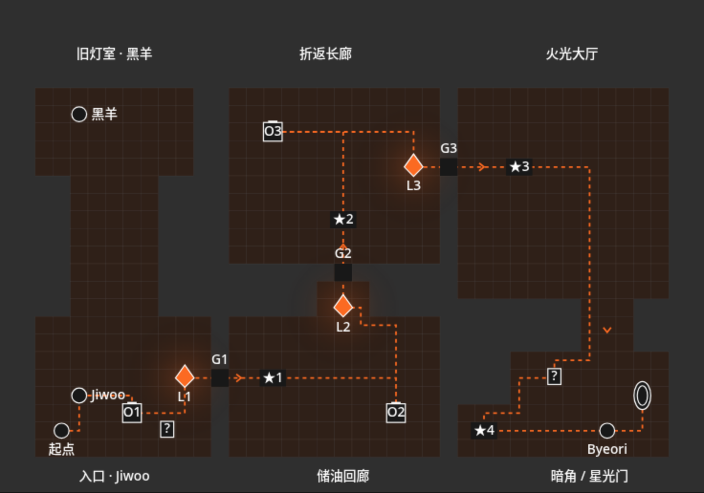
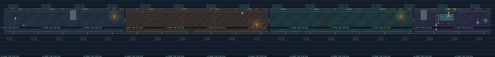
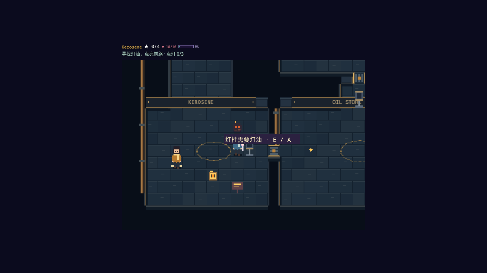
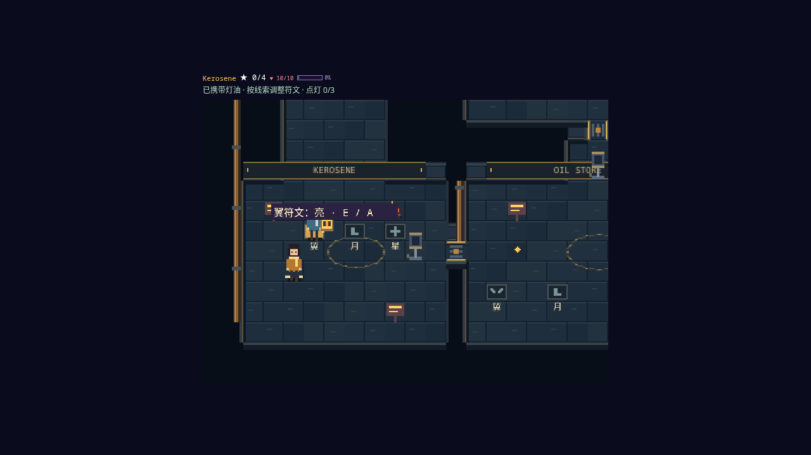
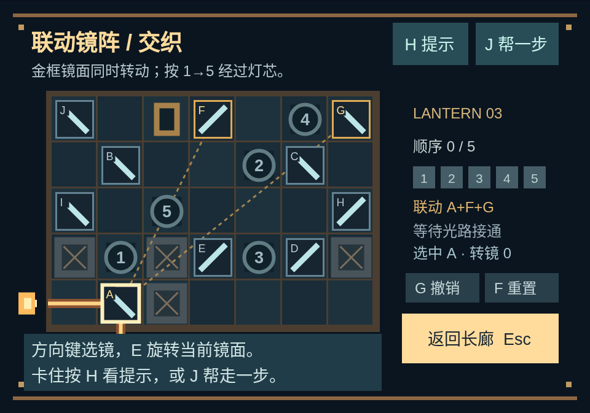
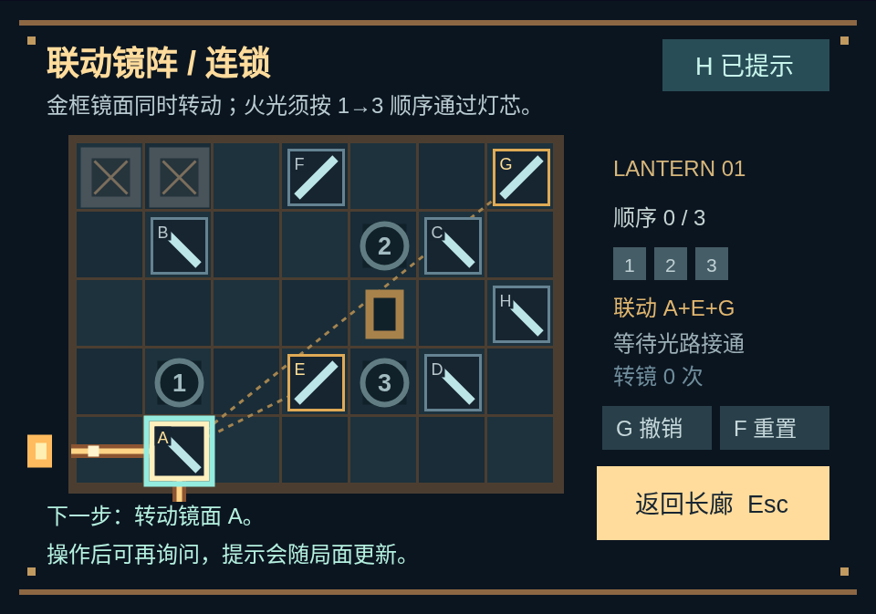
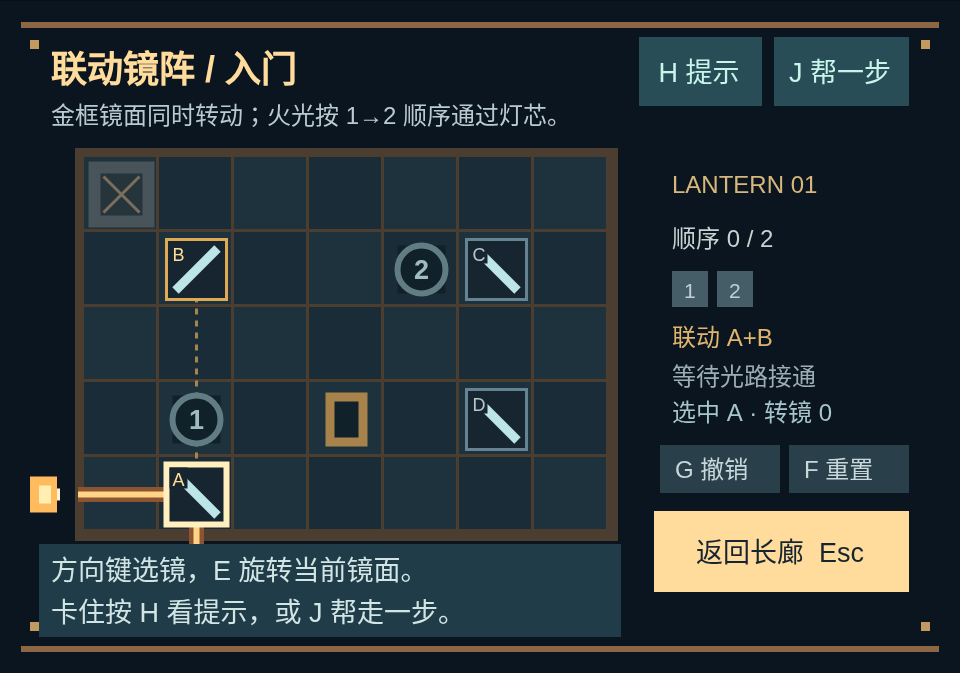
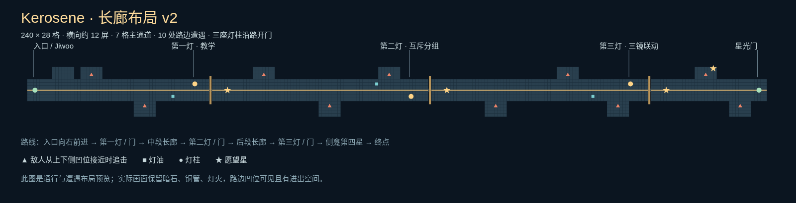
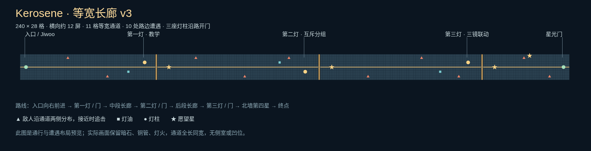

# 第二关 Kerosene — 布局与本地验收

2026-11-18 · Issue #11 · 当前为超长回廊 + 路边遭遇 + 独立光路小游戏版，尚未提交或发布。下方布局草案和分阶段验收保留为历史记录；最新玩法见本文末节。

图中的 O / L / G 分别表示灯油 / 灯柱 / 门，相同数字表示同组机关。图片展示三灯点亮后的路线；灯油和星星保留在原位便于评审，**不是运行时画面**。地图数据见 [layout-v1.json](layout-v1.json)，坐标从左上角 (0,0) 起算，单位为瓦片。

## 构图与氛围

- 地图 40×28 格，延续设计文档的暗夜蓝 `#0E1420`、火焰橙 `#FF7A00`、暖金 `#FFD166`。石砖地面、旧灯架、拱门和储油架形成地下长廊；Jiwoo 的信使主题用路标与翼形纹样点缀。
- 左下为入口与教学区；向右进入储油回廊，再向北上层折返，最后向右进入火光大厅、向南抵达出口。每次点灯都打开向前的必经门，下一颗星位于门后。
- 入口北侧的旧灯室是黑羊支路；出口西侧凹入的暗角放第四星，附近告示牌给出提示。两处都利用地形与光线引导探索。
- 庭室与通道保留清楚的地面边界；点灯增强局部暖光，未亮区域仍看得见道路。草案中的填色只是布局标识，实际光照范围待表现阶段校准。
- 普通连接走廊为 3–5 格宽；三处机关门口收为单格，与现有 GATE 实体相符。后续美术的实体装饰应沿墙放置，保留地面通行净宽。

## 建议游玩路线

1. 在 (3,24) 进入，向 Jiwoo (4,22) 了解携油点灯。接触 O1，靠近 L1 互动，G1 开启；门后收 ★1。
2. 在储油回廊向东南找到 O2，回到北侧 L2 点灯，通过 G2 收 ★2。
3. 上层长廊向西取 O3，再向东到 L3 点灯，通过 G3 收 ★3。
4. 从火光大厅沿右侧通道向南，读提示牌后向西进入暗角收 ★4，再回到 Byeori 与星光门。

| 组 | 灯油 O | 灯柱 L | 门 G | 门后星 |
|---|---|---|---|---|
| 1 | (7,23) | (10,21) | (12,21) | ★1 (15,21) |
| 2 | (22,23) | (19,17) | (19,15) | ★2 (19,12) |
| 3 | (15,7) | (23,9) | (25,9) | ★3 (29,9) |

三个区域按门顺序开放，各区域只提供一罐新灯油和下一根未点灯柱。因此携油上限一罐时也能前进，灯油不会被锁在自己要开启的门后。

| 探索点 | 坐标 | 用途 |
|---|---|---|
| 黑羊旧灯室 | (4,6) | 入口可达的可选支路，沿用 `l2.sheep` |
| 暗角星 ★4 | (27,24) | G3 后可达，不增加第四扇门 |
| 灯油提示牌 | (9,24) | 教学：接触拾油，E / A 点灯 |
| 暗角提示牌 | (31,21) | 指向西侧石拱后的探索点 |
| Byeori | (34,24) | 门旁提示；草案新增 `l2.byeori.hint` 文案 |
| 星光门 | (36,22) | 四星齐后激活，规划目标为关 3 |

## 布局阶段的复用与验证

沿用当前数据的 OIL / LAMP / GATE 和一次一罐规则，复用现有机关与校验器。交互驱动门状态的参考为 [Solarus 开关事件](https://docs.solarus-games.org/lua-api/map-entities/switch/)；此草案没有引入外部代码或素材。

- 将草案数据临时注入现有校验器，第二关的结构、实体、星数、引用、NPC 与状态图规则全部通过，0 错误 / 0 警告。正式 `js/data.js` 保持原内容。
- 四阶段地面连通检查：入口 / G1 开 / G1+G2 开 / 三门全开，分别可达 165 / 268 / 389 / 606 格。各门后星不会提前可达；各罐灯油能在对应门打开前拿到。
- 现有状态图搜索证明一次游玩可携油点三灯、收齐四星并到达终点；这是逻辑布局检查。玩家实际移动、拾油点灯、存档和手机操作留到接线阶段验收。
- 交互预览在 736px / 320px 内容宽度、浅色 / 深色主题检查：点灯阶段与路线显示切换正常，无页面异常或水平溢出；窄屏人物用 J / B / 羊 / 起简写。
- 仓库回归：`npm ci`、48 份 JS 语法、engine / main / level1 / auth / account / cloud / stats / channels / rings 九套检查与第一关单关校验通过；本地 HTTP 页面正常启动，无浏览器异常。全量地图校验仍为尚未制作关卡等 48 项既有错误，草案通过不等于运行时第二关完成。

## 运行时接线与验收（2026-11-11）

已接入 `js/data.js` 的正式第二关：第一关结算按钮进入 Kerosene；接触拾油，一次一罐；靠近未亮灯柱按 E / A 点亮、消耗灯油并打开对应门；收齐四星进入结算。第三关尚未制作时返回标题，存档保留在第二关。Jiwoo / Byeori 提示、黑羊与两块告示牌均可互动。

- [桌面入口](runtime/desktop-entry.png)、[第三灯与火光大厅](runtime/desktop-lamp3.png)、[四星出口](runtime/desktop-exit.png)、[竖屏模拟触屏第二灯](runtime/portrait-lamp2.png)。这些是实际游戏画面，已更新为第一轮像素表现版本。
- 拾油、用油与点灯记录保存在现有 `played` 数组的 `puzzle:2:oil:<id>` / `puzzle:2:used:<id>` / `puzzle:2:lamp:<id>` 标记中。读档在入口恢复携油、已点灯柱与派生门状态；重玩清本关机关与星，保留其他关和已播对话。沿用 v1 存档与云端数据结构。
- 修正连续移动的浮点累计误差导致单格门口误碰邻墙的问题；极小数值误差被吸收，真实越界与关闭门继续阻挡。校验器按关卡匹配同名成员，避免两关的 Jiwoo / Byeori 对话产生错误警告；油罐与灯柱 id 在数据校验边界检查。
- 第一、二关单关校验均为 0 错误 / 0 警告；第二关状态搜索通过，三处“油锁在自己门后”的反例均被拒绝。全量仍有 42 项未制作关 3–6 等错误 / 0 警告（由 48 项减少到 42 项）。
- Node 验收覆盖第一关通关衔接、旧第一关通关档继续、无油提示、隔墙不能点灯、携带上限、重复按键、六个拾油 / 点灯时点的保存继续、四星结算和再次重玩；共享地图不被运行时改写。
- `tools/smoke-level2.js` 使用实际键盘事件与触屏按键的 PointerEvent 监听，在桌面 / 模拟触屏竖屏 / 横屏走完整路线，途中携油和点灯后保存继续、核对通关档 `[1,2]`、通关档恢复和重玩；无页面 / 控制台异常。模拟触屏不替代真实手机验收。
- `npm ci`、51 份 JS 语法、13 套 Node 脚本（engine / main / level1 / level2 / auth / account / cloud / stats / channels / rings / collision / password-recovery / build）、校验器 42 项自测与生产构建通过。四个浏览器脚本 level2 / build / level1-collision / level1-actors 通过，均无页面异常。检查日志在忽略目录 `.ds/level2-checks/`，第二关完整运行截图 / 结果在 `.ds/level2-smoke/`。

改动范围：`js/data.js`（地图 / 对话）、`js/main.js`（拾油 / 点灯 / 恢复 / HUD / 绘制）、`js/engine.js`（门口浮点边界）、`js/sprites.js` / `js/audio.js`（基础瓦片 / 灯油与点灯音效）；`tools/validate.js`、engine / main / level1 / level2 测试和两关通关工具、第二关浏览器冒烟；PLAN、GAME_DESIGN 和本预览目录。

## 第一轮表现与音乐（2026-11-11）

- `MIXX.Kerosene` 在每次载入关卡时，按地图地面 / 墙体烘焙一张 640×448 的静态背景，每帧只取当前镜头。参考 [Solarus 静态瓦片预合成](https://docs.solarus-games.org/lua-api/map-entities/tile/) 的成熟方式；未引入第三方代码或新运行依赖。
- 稀疏大石板、铜管铆钉、旧灯室的信使翼纹、五块区域墙牌、嵌墙储油架与地面铜纹区分场景。静态装饰沿已存在的墙摆放；地图与机关坐标不变。铁门按横向 / 纵向通道绘制，通关星光门显示四枚星灯。
- 主角与 Jiwoo 改用长身比例的像素外套造型，脚步随移动变化；Byeori 以浮动星形绘制。灯火与角色动作使用关卡时间，暂停时冻结；第一关仍用其原有画面与角色体系。
- 原创灯笼爵士为 96 BPM、8 小节、20 秒循环，Dm9 → G13 → Cmaj7 → A7，软键盘、拨奏低音与轻刷拍；没有使用专辑录音或旋律。运行时现场合成并缓存单声道 PCM（22,050Hz，约 1.68MiB），`AudioBufferSourceNode.loop` 播放，音符尾音跨循环混合，无定时调度或额外音频网络请求。[试听 WAV](kerosene-bgm.wav) 仅供评审，不进入发布包。
- 音乐在首次用户操作解锁后启动；对话中继续，暂停 / 隐藏页面 / 关闭声音时停止并保留位置，恢复后续播。离关和销毁停止播放器，反复进入 / 重玩复用合成缓冲，不叠音。行为参考 [Web Audio 循环缓冲](https://developer.mozilla.org/en-US/docs/Web/API/AudioBufferSourceNode/loop)。
- `tools/test-audio.js` 验证手势、20 秒时长、音频信号、峰值余量、循环边界、缓冲复用、暂停续播、静音、换曲与无音频能力降级。浏览器使用真实 AudioContext 检查三种屏幕下的音乐状态、对话、静音、visibilitychange、结算、重玩和销毁，同时走完整四星路线。

本轮主要改动为 `js/sprites.js` 的背景 / 人物绘制、`js/audio.js` 的原创循环、`js/main.js` 的绘制和音乐状态接线，以及 audio / main / build / 浏览器测试。新版截图与试听见本目录；原有存档和机关规则保持一致。

本轮验收：`npm ci`、52 份 JS 语法、包含 audio 在内的 14 套 Node 脚本、第一 / 二关单关校验、生产构建通过；新版第二关三种屏幕的完整路线 / 音乐状态和打包第一关浏览器冒烟通过，无页面 / 控制台异常。全量仍为关 3–6 等 42 项待制作错误 / 0 警告。日志在 `.ds/level2-presentation/`，真实手机尚待试玩。

## PC 试玩包与验收

用户选择 PC 为下一轮目标，已补充[PC 试玩说明与验收矩阵](PC_PLAYTEST.md)。可运行 `node tools/build-pc-playtest.js` 生成 ZIP，解压后打开 `kerosene.html` 直接试玩第二关，或打开 `index.html` 验证完整流程。两个入口用独立试玩存档。

## 战斗版（2026-11-11）

用户认为纯取油点灯单调，并要求加入战斗。第二关现启用已有的应援棒系统：F 轻击 / G 重击，能量满后任一攻击释放能量炮；携油时同样能攻击。入口慢速灰烬团、第二罐油旁守卫、上层火灵、大厅耐打灰烬团、暗角追击火灵形成五处遭遇，数值与坐标见 GAME_DESIGN §5.2。

- 灰烬团与火灵是 `dreamling` / `wisp` 的主题像素造型；沿用追击、前方锁敌、墙体视线阻挡、击退、HP 和能量规则。新增待机应援棒、受伤闪烁及满能量提示；HP / 能量 HUD 和触屏攻击键随战斗开启。
- 倒下回入口满血复起，敌人复位；保留携油、已消耗油、点灯、门与星。读档 / 重玩会重置 HP、能量和敌人，存档格式不变。对话与暂停冻结战斗。通关仍以四星为目标，可战斗或绕开敌人。
- [重击](runtime/combat-heavy.png)、[能量炮](runtime/combat-cannon.png) 来自 PC 包实际键盘触发。浏览器以满能量 / 低血量夹具验证蓄能分支和倒下；伤害、追击、接触与复起由真实游戏循环执行。正常充能 / 冷却 / 视线规则继续由引擎回归覆盖。
- Node 用例覆盖轻重击、能量炮、暂停、倒下保油 / 灯 / 星、读档重置战斗及源地图只读。第二关通关工具在遭遇时停步迎击；桌面 / 横竖屏冒烟走通三灯四星。PC 解压包的四种窗口 / 离线场景、刷新读档和原存档隔离继续通过，包已更新为战斗版。

本轮改动为 `js/data.js` 的五只敌人与提示、`js/sprites.js` 的战斗造型 / 受伤反馈、`js/main.js` 的绘制分派，以及 main / level2 / 两种浏览器冒烟、PC 打包说明与通关工具。第一关继续保持无战斗。

战斗版验收：54 份 JS 语法、14 套 Node 脚本（main 161 项）与第一 / 二关数据校验通过；第二关三种屏幕的移动 / 遭遇 / 点灯 / 四星流程及解压后的 PC 原生按键战斗、离线 / 读档通过，无浏览器异常。全量仍为关 3–6 等 42 项待制作错误 / 0 警告。日志位于 `.ds/level2-combat/` 与 `.ds/pc-playtest/`，45 个包内文件已逐一核对哈希；未提交、推送或发布。

## 关联符文谜题（2026-11-11，历史版本，已替换）

每根灯柱多了三枚可踩过的翼 / 月 / 星符文；靠近按 E / 空格 / A 切换亮暗，按照同区域线索牌推理后，带着灯油给灯柱添油。三组分别是谜语选择、前组的明暗倒影、取前两组特征做组合，完整解法记录在 GAME_DESIGN §5.2（含剧透）。战斗与三灯四星路线保留。

- 答错只给提示，不消耗灯油、不关闭已开的门；可反复调整。
- 点亮后符文封存，可沿已开门回看之前的亮暗；未完成的调节随现有存档保存，倒下保留、重玩清空。
- 旧版已经点亮的灯会恢复对应正确组合，无需重新解；未点亮的灯使用新谜题。存档仍为 v1，不增加云端结构。
- 数据校验保证每灯三个布尔答案与九枚符文的目标 / 槽位 / 标签；状态图把亮暗组合和封存也纳入搜索。回归验证三组解法与线索关系，并拒绝“必需符文放在自己门后”的反例。
- PC 包以实际 E 键切换第一枚符文、尝试错解，整页刷新后恢复未完成状态，再解完开门；完整三组解谜、战斗和四星流程在 PC / 离线及第二关横竖屏冒烟通过。

改动集中在 data / engine / main / sprites、地图校验、两关通关与测试工具和 PC 包说明。新版包运行 `node tools/build-pc-playtest.js` 生成；验收日志在 `.ds/level2-runes/` 与 `.ds/pc-playtest/`。

本轮验收：14 套 Node 检查（main 162 项）、校验器 42 项自测、第一 / 二关单关数据校验、54 份 JS 语法通过。第二关桌面 / 模拟横竖屏、解压 PC 包的四种窗口 / 离线场景及第一关打包冒烟通过，无页面异常。全量仍为后续关卡等 42 项错误 / 0 警告；未提交、推送或发布。

下一阶段：PC 人工试玩后按画面、手感与音乐反馈微调。手机实测保留为后续独立验收。

## 独立光路小游戏（2026-11-16，第一版，难度已修订）

根据用户反馈，移除九枚地面符文和三块谜语告示牌。带油靠近灯柱按 E，画面切入灯柱内部的光路棋盘，通过旋转反射镜直接观察火光变化，无需阅读谜语或回地图抄答案。

- 「引火」5×4、2 镜 / 1 芯；「回流」6×4、4 镜 / 2 芯；「折光」7×5、6 镜 / 3 芯。圆环为必经灯芯、方框为出口，光束与点亮状态即时变化。
- 鼠标点击镜面旋转；方向键 / WASD 选镜、E / 空格旋转、F 重置。全部接通后 E 或「点灯返回」消耗灯油并开门，Esc /「返回长廊」中止而不耗油。
- 独立 PUZZLE 状态冻结玩家、敌人与战斗充能，音乐继续；解题计入关卡游玩时间。旋镜与解开标记沿用现有 `played`，退出后可在暂停菜单保存。旧已点灯存档可继续，重玩清空光路进度。
- `js/lantern.js` 负责光路、棋盘与命中，main 负责状态、进度和点灯。校验器使用同一光路逻辑穷举可解性，再纳入三油三灯路径搜索，包含无解反例。
- PC 包覆盖三种窗口 / DPR 与离线 file://，实际鼠标与键盘旋镜、重置、退出 / 刷新恢复、确认点灯；独立画面的战斗冻结通过。第二关桌面 / 模拟横竖屏可三棋盘、三灯、四星通关。

截图：[引火](runtime/light-puzzle1.png)、[回流](runtime/light-puzzle2.png)、[折光](runtime/light-puzzle3.png)、[接通反馈](runtime/light-solved.png)。原有战斗和四星路线继续保留。

光路版验收：npm ci、55 份 JS 语法、14 套 Node 检查（main 162 项）、校验器 42 项自测与第一 / 二关单关校验通过；PC 四种窗口 / 离线、第二关桌面 / 模拟横竖屏和第一关打包冒烟通过。严格全量仍为后续关卡等 42 项错误 / 0 警告。日志 `/tmp/mixxtopia-optics-*.log`，最新版包 45 个解压文件及 ZIP 校验通过；未提交 / 推送 / 发布。

## 联动镜阵（2026-11-16，当前版本）

用户认为逐面转镜太简单，现改为每次操作同时转动金框所示三面镜子；编号灯芯必须按顺序经过，挡板阻断光线。选中 / 悬停预览字母、虚线与影响范围，G /「撤销」回退本次进入后的操作，F /「重置」恢复初始布局。

三张棋盘均为 7×5，分别有 8/9/10 面镜子、3/4/5 枚编号灯芯、2/3/4 块挡板。BFS 验证初始最短解分别为 6/7/8 次操作，且所有镜面各点一次不能直接完成。没有限时与步数失败惩罚，仍可随时退出、不耗油、保存旋镜进度。

实现为 `js/lantern.js`、`js/main.js`、`js/data.js` 及通关 / 回归 / PC 验收工具。棋盘 version:2 的旋镜与完成标记独立于旧布局；已点灯旧存档继续保留，尚未点灯旧棋盘从新布局开始。最新日志 `/tmp/mixxtopia-gear-*.log`。

联动版验收：npm ci、55 份 JS 语法、14 套 Node 检查（main 162 项）、校验器 42 项自测及第一 / 二关单关校验通过。PC 三种窗口 / DPR 与离线 file://、第二关桌面 / 模拟横竖屏、第一关打包冒烟通过；无页面异常，45 个解压文件核对通过。严格全量仍为后续关卡等 42 项错误 / 0 警告，未提交 / 推送 / 发布。

## 逐级提示（2026-11-16，当前版补充）

卡住时按 **H** 或点击右上角「提示」。第一层标出观察目标，第二层标出可入手的联动组，第三层指出并高亮下一步镜面；每次转镜后按新局面重新分析。看提示不转镜、不耗油、不计操作次数；G 撤销与 F 重置继续可用。

逻辑复用实际联动搜索，提示后的建议操作会使当前最短剩余解减少一步；没有一次性展示完整答案。变更集中在 `js/lantern.js`、`js/main.js`、`js/engine.js`、Jiwoo 说明，以及回归与 PC 包工具。日志 `/tmp/mixxtopia-hints-*.log`。

提示版验收：npm ci、55 份 JS 语法、14 套 Node 检查（main 162 项）、校验器 42 项自测、第一 / 二关单关校验通过；PC 三种窗口 / DPR、离线 file:// 与第二关桌面 / 模拟横竖屏通过。实际鼠标 / H 逐级展开提示后不转镜，执行建议动作后旧提示清除；45 个解压文件与 ZIP 校验通过。严格全量仍为后续关卡等 42 项错误 / 0 警告。未提交 / 推送 / 发布。

## 常驻引导版（2026-11-16，最新）

进入机关就能看见亮色的「下一步：点镜面 X」，高亮对应镜面，任何操作后立即更新。J 或大按钮「帮我走一步」可执行建议一步，G 可撤销；H 仅重新显示建议。第一盏灯改为 4 镜双镜联动、3 步教学，后两张保留进阶谜题，并同样提供常驻引导。

新入口为 PC 包内 `kerosene-guided.html`，标题标示「引导版 · 常驻下一步」，与原第二关入口共用试玩存档；ZIP 46 文件。改动集中在 lantern / main / engine、第一灯数据与通关 / 回归 / PC 工具；日志 `/tmp/mixxtopia-guided-*.log`。

常驻引导版验收：npm ci、55 份 JS 语法、14 套 Node 检查（main 162 项）、校验器 42 项自测、第一 / 二关单关校验通过；PC 三种窗口 / DPR 与离线 file://、第二关桌面 / 模拟横竖屏通过，无页面异常。默认下一步、鼠标 / J 帮走、G 撤销、持久在线索与刷新读档已核对；46 个解压文件及 ZIP 校验通过。全量仍为后续关卡等 42 项错误 / 0 警告，未提交 / 推送 / 发布。

## 一对一配对（2026-11-16，最新）

按用户要求「每一个节点都只有一个关联」，三张棋盘均改为独立双向配对：A 只关联 B，B 也只关联 A，点击只改变这一对。镜面数 4/8/10，灯芯 2/4/5，最短解降为 2/3/4 次。保留编号顺序、挡板、常驻下一步与「帮我走一步」。

所有棋盘 version:4，旧已点灯进度保留，未完成旧镜阵的镜向不套入新的配对状态。`js/lantern.js` 在配置边界拒绝多关联与非双向关联，`tools/test-level2.js` 对每个节点验证只影响自己和搭档；地图、通关、读档与 PC 包同步更新。最新日志 `/tmp/mixxtopia-pairs-*.log`。

试玩入口仍为 `kerosene-guided.html`，标题更新为「一对一配对 · 常驻引导」。未提交 / 推送 / 发布。

配对版验收：npm ci、55 份 JS 语法、14 套 Node 检查（main 162 项）、校验器 42 项自测与第一 / 二关单关校验通过；PC 三种窗口 / DPR、离线 file:// 及第二关桌面 / 模拟横竖屏通过，无页面异常。46 个解压文件已逐一核对。严格全量仍为后续关卡等 42 项错误 / 0 警告。未提交 / 推送 / 发布。

## 范围纠正：只简化第二个灯柱（2026-11-16，最新）

用户明确「第二关」是第二个灯柱。已撤回误扩大的全局配对：第一灯恢复原 version:3 教学（4 镜、3 步），第三灯恢复原 version:2 三镜联动（10 镜、8 步）。仅第二灯保留 version:4 / paired:true 双向一对一配对（8 镜、3 步），常驻引导与 J 帮走继续保留。

通用机关校验恢复支持多关联；`paired:true` 的棋盘单独强制唯一双向配对。回归明确检查只有第二灯开启此模式，并检查第一 / 第三灯原联动与镜向。入口仍为 kerosene-guided.html，标题为「第二灯一对一 · 常驻引导」。日志 `/tmp/mixxtopia-lamp2-only-*.log`。未提交 / 推送 / 发布。

范围纠正版验收：npm ci、55 份 JS 语法、14 套 Node 检查（main 162 项）、校验器 42 项自测、第一 / 二关单关校验通过；PC 三种窗口 / DPR、离线 file:// 与第二关桌面 / 模拟横竖屏通过。46 个解压文件核对通过，无页面异常；全量仍为后续关卡等 42 项错误 / 0 警告。未提交 / 推送 / 发布。

## 手动解谜与主动 J（2026-11-18，最新）

修复提示自动改选，导致连续按 E 等同帮走的问题：E 只转当前玩家选中，提示从不改变选择；进入与旋镜后不自动显示答案。三张棋盘均保留可选 H /「提示」与 J /「帮一步」，按用户最新要求三个都能用 J。H 只标记建议，J 明确求解执行一步；J 后按 E 仍反转同一组，不能自动接着通关。

第一、二灯作为自行解题段，第三灯的复杂联动提供可选帮助；棋盘布局 / 联动及保存版本 3/4/2 均未改变，第二灯继续一对一配对。修复在 `js/lantern.js` 与 `js/main.js`，帮助配置在 data，回归与 PC 包同步更新。日志 `/tmp/mixxtopia-manual-*.log`，入口仍为 kerosene-guided.html，标题「第二灯一对一 · 手动解谜」。未提交 / 推送 / 发布。

手动操作版验收（2026-11-18）：npm ci、55 份 JS 语法、14 套 Node 检查（main 163 项）、校验器 42 项自测、第一 / 二关单关校验通过。PC 原生按键验证连续 E 不自动求解、H 不改选、三灯均可 J、J 后 E 不继续推进；PC 三种窗口 / DPR / 离线及第二关桌面 / 模拟横竖屏通过，无页面异常。46 个解压文件核对通过。严格全量仍有后续关卡等 42 项错误 / 0 警告；未提交 / 推送 / 发布。

## 第二灯互斥分组（2026-11-18，最新）

用户明确要「几个镜面同时转动，每面不要属于几个组」。仅第二个灯柱改为第 1 组 A/C/E、第 2 组 B/D/G、第 3 组 F/H，共 3/3/2 面；点击任意成员整组一起旋转，其他组不动，每面只属一组。颜色与组号常驻，选中时预览本组全部成员。第一、第三灯配置不变；E 手动、H 提示不改选、三个 J 均继续可用。

第二灯 version:5，仅未点灯的旧第二灯镜向不套入新分组；旧已点灯进度保留。配置校验拒绝漏分组、重复分组与额外关联。逻辑、求解、撤销和影响范围绘制共用 `affected()`；PC 原生点击 A 验证只改变 A/C/E，再 G 撤销。入口标题「第二灯分组 · 手动解谜」，日志 `/tmp/mixxtopia-groups-*.log`。

分组版验收：npm ci、55 份 JS 语法、14 套 Node 检查（main 163 项）、校验器 42 项自测、第一 / 二关单关校验通过。PC 三种窗口 / DPR / 离线及第二关桌面 / 模拟横竖屏通过，无页面异常；46 个解压文件核对通过。实际点击 A 只转整组 A/C/E，G 恢复，连续 E 不自动求解，H 不改选，三个 J 均有效。严格全量仍有后续关卡等 42 项错误 / 0 警告；未提交 / 推送 / 发布。

## 超长回廊（2026-11-18，历史凹位版本）

用户确认镜阵后要求改为很长的长廊，路边出现敌人。地图现为 240×28 格、横向约 12 屏、7 格主路，三座灯柱沿路打开三道石拱门。上下侧交错 10 处敌人凹位，接近时追出，可迎击或绕行；镜阵与 E / H / J 规则保持已确认版本。

机关 / 敌人坐标、通行与表现说明见 [CORRIDOR.md](CORRIDOR.md)。先制作布局预览并验证门前灯油 / 四星可达，再接入正式数据；运行图见 runtime/corridor-entry.png、corridor-encounter.png、corridor-end.png、overview.png。旧 v1 布局和分阶段记录仅作历史追溯。

长廊版验收：npm ci、55 份 JS 语法、14 套 Node 检查（main 164 项）、校验器 42 项自测与第一 / 二关单关校验通过。PC 三种窗口 / DPR / 离线、第二关桌面 / 模拟横竖屏的全长路线与第一关打包冒烟通过，无页面异常。上下敌人真实 AI 追入主路、不穿墙；三道门无法绕过，灯油在各自门前可达，远端镜头 x>3200，整图按 3840×448 拼接。46 个解压文件核对通过，严格全量仍为后续关卡等 42 项错误 / 0 警告；未提交 / 推送 / 发布。

## 等宽长廊（2026-11-19，第一轮）

取消所有侧室 / 凹位和局部加宽，主通道从 7 格加宽到 11 格（y5–15），全长 240 格。10 只敌人沿通道内两侧墙分布（y6 / y14），靠近后追击；黑羊和第四星也在通道内。三道门的单格门口保留，三张镜阵、E / H / 三灯 J 和保存版本均保持。

当前布局源为 corridor-v3.json / svg，详情见 [CORRIDOR.md](CORRIDOR.md)；试玩入口更新为同一个 kerosene-guided.html。

等宽版验收（2026-11-19）：55 份 JS 语法、14 套 Node 检查（main 164 项）、校验器 42 项自测与第一 / 二关单关校验通过。全长剖面检查无凹位 / 局部加宽，两侧真实 AI 向中线追击且不穿墙；PC 三种窗口 / DPR / 离线 file://、第二关桌面 / 模拟横竖屏通关与保存读档通过，无页面异常，46 个包内文件核对通过。严格全量仍为后续关卡等 42 项错误 / 0 警告；未提交 / 推送 / 发布。日志 /tmp/mixxtopia-wide-*.log。

## 玩法与环境改进（2026-11-19，当前）

借鉴攻击预告、移动战斗和补给节奏，加入 Shift / D 闪步、橙 / 蓝圈预警、重击打断、点灯休整。等宽长廊增加四段材质 / 墙面设备、四组喷口和混合遭遇，喷口也能伤敌。三张镜阵保持。当前地图源 corridor-v4.json，借鉴来源 / 数值 / 验收说明见 [GAMEPLAY.md](GAMEPLAY.md)。

玩法与环境版验收（2026-11-19）：55 份 JS 语法、14 套 Node 检查（engine 57 项、main 165 项）、校验器 42 项自测及第一 / 二关单关校验通过。PC 三种窗口 / DPR / 离线 file://、桌面 Shift / 模拟触屏 D、三灯四星全长路线与保存读档通过，无页面异常；独立离线浏览器验证闪步躲落点、G 打断、喷口伤敌 / 旁路安全。46 文件核对通过，严格全量仍为后续关卡等 42 项错误 / 0 警告。日志 /tmp/mixxtopia-tactical-*.log。未提交 / 推送 / 发布。

## 水渠机关更新（2026-11-21，当前）

已参考古墓丽影环境机关加入排水—滑轨推筏—系配重绳—放水升石罩，解锁第四星。H / 点击「观察」可看当前提示，南侧可复位，部分进度保存 / 旧已收星兼容；保持 11 格等宽长廊和三灯原镜阵。当前地图 corridor-v5.json，详见 [RUINS.md](RUINS.md)。新增独立 `ruins.html` 机关直达试玩，不影响原 kerosene-guided.html / 正式存档。

水渠机关版验收（2026-11-21）：55 份 JS 语法、14 套 Node 检查（engine 58 项、main 167 项）、校验器 42 项自测及第一 / 二关单关校验通过。桌面键盘 / 模拟横竖屏触控真实推筏、系绳、放水和 H / 点击观察通过；部分进度 / 旧四星档 / 重玩通过，三灯四星完整路线与 PC 离线 file:// 通过，无页面异常。机关直达入口新游戏与读档均验证，47 文件及 ZIP 核对通过。严格全量仍为后续关卡等 42 项错误 / 0 警告。日志 /tmp/mixxtopia-ruins-*.log；未提交 / 推送 / 发布。

## 暗器机关初版（2026-11-21，已由下方重做版替换）

上轮只补水机关，本轮补齐墙面箭阵（两处）、压力地刺、悬链摆刃 / 制动杆。均有可见线索与普通伤害，可走位 / 绕行 / 拉杆；制动进度可保存。新增 traps-darts.html、traps-spikes.html、traps-blade.html 三个独立直达入口，水渠入口和完整关卡保持。当前源 corridor-v6.json；设计、参考和检查见 [TRAPS.md](TRAPS.md)。

## 暗器重做（2026-11-21，当前）

当前配置 corridor-v7.json。两处铜踏板触发单侧一轮箭；两道宽两格的定时地刺间留三格安全等待地面；巨大摆刃换成轨道闸刃，制动杆移至出口侧 (170,6)。敌人 / 蒸汽与机关观察区错开，普通步行可无伤通过。三个直达入口标题标注「暗器重做版」，完整关卡同步；详见 [TRAPS.md](TRAPS.md)。

### 自动箭阵更新（2026-11-21，当前）

按用户「箭不需要人为触发」：两处箭阵移除踏板与连杆，固定每 5 秒发射一轮，预警 1 秒，玩家可观察后利用间隙通过。发射不依赖任何角色进入或操作，离开后仍继续。配置仍为 corridor-v7.json；其余重做机关不变，详见 TRAPS.md。
