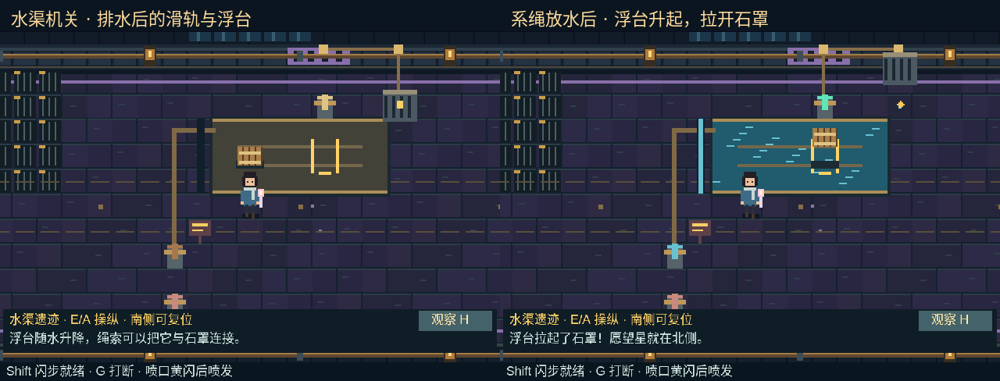

# 水渠遗迹机关 · 2026-11-21

借鉴《古墓丽影》的环境因果机关，在终段第四星处加入「水闸—滑轨浮台—配重绳—石罩」联动。玩家始终留在长廊画面，看到每个装置如何带动下一个装置。

## 参考依据

- [古墓丽影官方机关回顾](https://www.tombraider.com/news/video-games/9-tomb-raider-puzzles-that-had-us-all-stumped)：列举绳索 / 滑轮、水位与平台等机关。本轮采用环境装置的组合方式，没有照搬原作地图或谜题答案。
- [《暗影》关卡设计师 Richard Pau 的水渠古墓拆解](https://www.paurichard.com/shadow-of-the-tomb-raider)：通过排水、移动浮台、系绳和重新注水，让浮力牵动门；强调先展示目标，再让玩家通过试验理解装置关系。当前版本用适合二维长廊的浅水槽、水平滑轨和升降石罩改编。

代码、美术与音效沿用本项目原创实现，没有导入上述游戏的代码或素材。

## 当前玩法

- 第四颗星在 (220,6)，开局可见石罩内的星光，石罩升起前无法拾取。三座灯柱镜阵、三个 J 与保存版本 3/5/2 保持。
- 浅水槽 x213–219 / y7–9，浮台初始 (214,8)，只能沿 x214–218 的滑轨水平推动；金色卡槽位于 x217，推过头可以从右侧推回。
- 水闸 (211,12)：E / A 放水或排水，约 1.7 秒升 / 降至稳定水位；水位计、波纹和浮台升降同步显示。水槽是可步行浅槽，没有新增游泳或即死机制。
- 绳柱 (217,6)：仅排净水且浮台对齐卡槽时能系绳。系绳后浮台锁定，解绳可继续调整；有水时需先排水。
- 复位 (211,14)：排水、解绳、浮台回起点；不能通过复位获得星星。
- H / 点击「观察」：按当前状态提示下一处值得观察的装置，不代替推筏、系绳或放水。动作失败也会说明当前缺少的条件。
- 水位升满、浮台已对齐且系绳后，石罩永久升起。仅在水闸旁重复按 E 无法解开。
- 机关区镜头保持纵向构图，让水闸操作时也能看见上方浮台 / 石罩；提示条最后绘制，避免被粒子挡住。

末段两只火灵移至 x203 / y14 与 x207 / y6，最后一组喷口移到 x204 / y5；水槽和操作位置没有喷口，先前的战斗 / 蒸汽玩法保留。主通道仍为 240 格长、11 格等宽，无侧室或凹位。

## 保存与检查

进度沿用存档 v1 的 played，标记前缀为 `puzzle:2:ruins:1:`：浮台位置、系绳、水闸、已完成。手动保存后恢复；水位动画不存逐帧数值，读档恢复水闸对应的稳定水位。已收第四星的旧存档直接显示机关完成，不要求重解；重玩清空机关，倒下保留在场进度。

地图校验纳入滑轨推行、水闸 / 系绳状态、奖励星前置条件。状态搜索将可自由等待的注 / 排水动画化为稳定水位状态，仍要求实际到达控制器、推动浮台到卡槽再系绳；滑轨被堵时不会判可通关。

Node 检查覆盖滑轨限位、浮起 / 系绳时锁定、重复 E 不解谜、H 不代操作、保存 / 旧档 / 重玩与暂停。浏览器用真实方向键和模拟触屏推动三格、系绳、放水，验证先放水不完成、石罩内的星不能提前拿、完整三灯四星路线通过。

## 试玩

- `ruins.html`：水渠机关直达试玩，独立存档，预置三灯 / 三星、无敌人干扰，新游戏 / 重玩 / 继续均在机关旁。
- `kerosene-guided.html`：完整第二关，正常走到终段后体验水机关，原试玩存档空间不变。
- `index.html`：序章、第一关、第二关完整流程。

入口都在 `.ds/pc-playtest/extracted/MIXXTOPIA-PC-Playtest/`。构建仍为 `node tools/build-pc-playtest.js`。

本轮修改：js/data.js（机关配置与奖励）、engine.js（滑轨限位）、main.js（水位 / 联动 / 存档 / 输入 / 取景）、sprites.js（机关绘制）、index.html（帮助）、tools/validate.js（配置与状态搜索）、对应 Node / 浏览器检查与打包工具。未提交 / 推送 / 发布。

水渠机关版验收（2026-11-21）：55 份 JS 语法、14 套 Node 检查（engine 58 项、main 167 项）、校验器 42 项自测及第一 / 二关单关校验通过。桌面键盘 / 模拟横竖屏触控真实推筏、系绳、放水和 H / 点击观察通过；部分进度 / 旧四星档 / 重玩通过，三灯四星完整路线与 PC 离线 file:// 通过，无页面异常。机关直达入口新游戏与读档均验证，47 文件及 ZIP 核对通过。严格全量仍为后续关卡等 42 项错误 / 0 警告。日志 /tmp/mixxtopia-ruins-*.log；未提交 / 推送 / 发布。

## 暗器机关初版（2026-11-21，已由下方重做版替换）

上轮只补水机关，本轮补齐墙面箭阵（两处）、压力地刺、悬链摆刃 / 制动杆。均有可见线索与普通伤害，可走位 / 绕行 / 拉杆；制动进度可保存。新增 traps-darts.html、traps-spikes.html、traps-blade.html 三个独立直达入口，水渠入口和完整关卡保持。当前源 corridor-v6.json；设计、参考和检查见 [TRAPS.md](TRAPS.md)。

## 暗器重做（2026-11-21，当前）

当前配置 corridor-v7.json。两处铜踏板触发单侧一轮箭；两道宽两格的定时地刺间留三格安全等待地面；巨大摆刃换成轨道闸刃，制动杆移至出口侧 (170,6)。敌人 / 蒸汽与机关观察区错开，普通步行可无伤通过。三个直达入口标题标注「暗器重做版」，完整关卡同步；详见 [TRAPS.md](TRAPS.md)。
